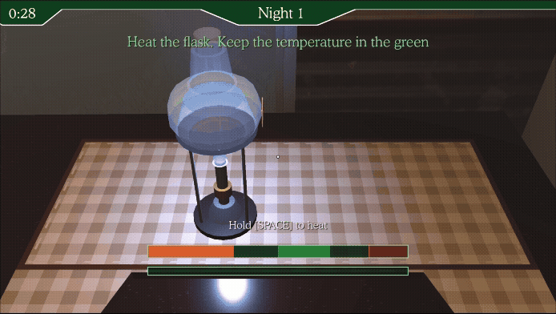
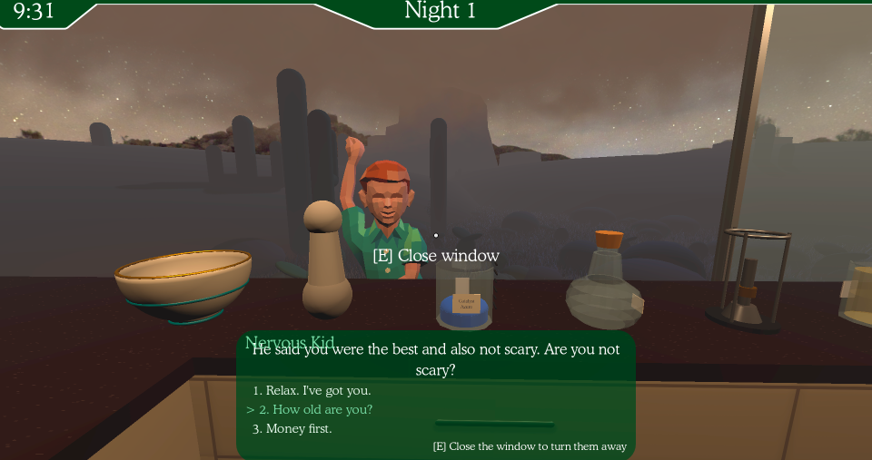
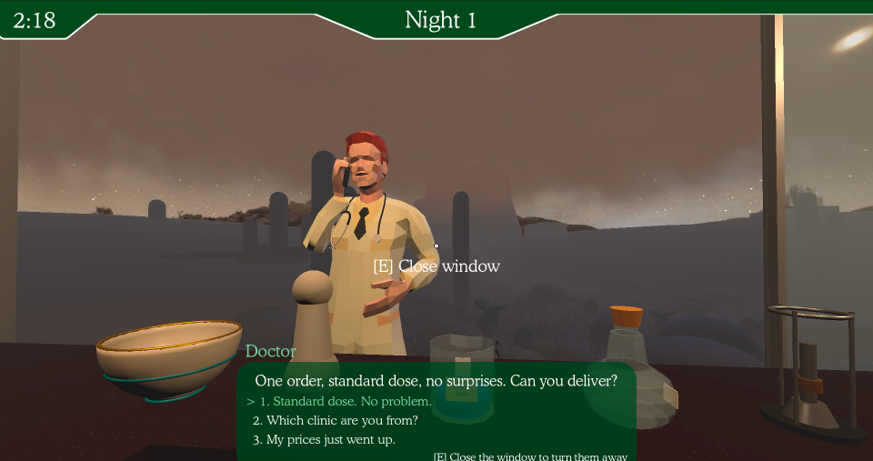
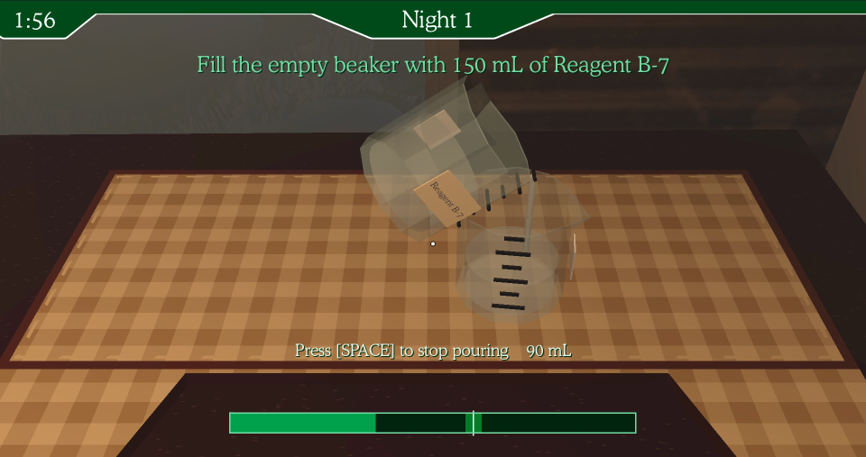
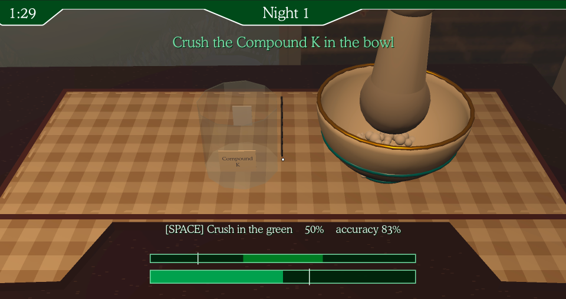

# Chem Lab

A Breaking Bad inspired crystal cooking simulator where players race against the time to serve customers, avoiding chemical explosions and undercover cops.
  Play the game <a href="https://emilyahmad.itch.io/chem-lab">here</a> or watch this <a href="https://youtu.be/bgGiz3wt0kk">video demo</a>

## Gameplay

Camera pans van exterior and desert environment, then the inside of the van. A few seconds later, customers begin appearing outside the van's window. Players can engage in dialogue, accepting customer's orders or denying them by closing the window. Once the first order is accepted, players are walked through the cooking sequence:
+ Pouring Agent B-7 into empty beaker
+ Crushing Compound K in a mixing bowl
+ Mixing the beaker and bowl's contents in an erlenmeyer flask
+ Heating the flask over a bunsen burner
+ Adding drops of a quench solution until the right shade appears

 Each step is evaluated and cumulates in a purity score on completion, and are compensated based on this metric.
 Some screenshots from gameplay:

Dialogue sequence with customers
 
 

Different stages of the cooking sequence
 
 

## Credits
[Customer sketchfab models](https://sketchfab.com/3d-models/low-poly-people-free-sample-pack-f2616c6a06c44841bf1ddf5e9486571e)
 Font<a href="https://www.onlinewebfonts.com/icon"> svg icons</a> licensed by CC BY 4.0